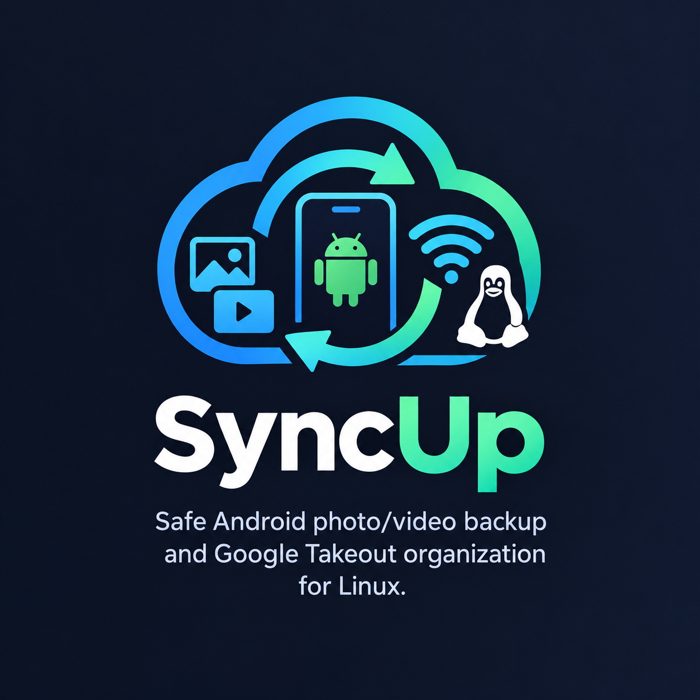

# SyncUp



Safe Android photo/video backup and Google Takeout organization for Linux.

SyncUp is built around one rule: **never replace or remove a destination file until the new copy has been written and verified**. It is a desktop app written in Python with Flet, with separate tabs for phone backup, Wi-Fi backup, Takeout organization, and duplicate cleanup.

## What is new in v1.4.0
* **Wi-Fi Backup Tab:** Send photos and videos directly from your phone to your PC over your local network. No cable required.
* **QR Code Scanner:** Instantly connect your phone by scanning a QR code generated by the PC.
* **Smart Mobile UI:** A lightweight, zero-install web page opens on your phone allowing you to select folders and track upload progress.
* **Crash-Safe Sync Engine:** Uploaded files are processed using the existing atomic, verified copy engine.
* **Automatic State Management:** The PC checks its SQLite database and only requests the missing/new files from your phone.
* **Atomic and crash-safe copies:** Data is written to a destination-local `.part-*` file, verified, flushed with `fsync`, and published with `os.replace()`.
* **SQLite backup state:** Replaces the old whole-file JSON state. Progress is committed in small transactions.
* **Streamed Takeout ZIPs:** ZIP archives are streamed member-by-member. SyncUp does not call `extractall()`.
* **Duplicate Finder:** Supports preview before moving, a manifest written before any move, and an undo action.
* **105 unit tests:** The test suite uses only the Python standard library `unittest`.
* **Professional Packaging:** AppStream metadata, reverse-DNS desktop entry, hicolor icon, and a bundled Flet desktop runtime.

## Workflows

### Phone Backup (MTP)
* Discovers Android devices exposed by `gvfs`/`gio`, with manual refresh.
* Browses phone folders in the app and supports multi-folder selection.
* Remembers destination, sorting, media filter, conflict mode, and folders per device.
* Detects changed files by path, size, and modification time.
* Deduplicates overlapping selected folders.
* Checks destination free space before copying.
* Stops after repeated errors instead of repeatedly retrying a disconnected phone.

### Wi-Fi Backup (New in v1.4.0)
* Starts a local HTTP server and displays a QR code.
* Phone scans the QR code, opens a mobile web page, and selects folders.
* Only missing files are uploaded, saving time and bandwidth.
* The PC processes uploads through the same crash-safe pipeline.

### Special Organizer (Google Takeout and folders)
* Streams ZIP members directly to their destinations.
* Uses Google Takeout sidecars (`photoTakenTime` / `creationTime`) when available.
* Supports `.json` and `.supplemental-metadata.json` sidecars.
* Supports day, month, year, and flat layouts.

### Duplicate Finder
* Uses a quick size plus head/tail hash check before a full BLAKE2b content hash.
* Shows a preview before anything is moved.
* Keeps the shallowest copy and moves duplicates into `_Duplicates_/`.
* Writes `_manifest.json` before the first move.
* Provides **Undo Last Move**.

## Installation

### Run from source
Requirements:
* Python 3.10 or newer.
* A Linux desktop with `gio`/`gvfs` for MTP access.

```bash
git clone https://github.com/Lotus-Projects-3421/syncup.git
cd syncup
python3 -m venv .venv
source .venv/bin/activate
python -m pip install -r requirements.txt
python main.py
```

### Run the built AppImage
The v1.4.0 build output is `dist/SyncUp_v1.4.0.AppImage`:

```bash
chmod +x dist/SyncUp_v1.4.0.AppImage
./dist/SyncUp_v1.4.0.AppImage
```

## Building the AppImage
Install the build dependencies and run the versioned build script:

```bash
python -m pip install -r requirements-build.txt
./build.sh
```

`build.sh` uses `.venv/bin/python` when it exists, or the `PYTHON` environment variable. It runs the test suite, regenerates the icon, builds with PyInstaller, assembles `AppDir`, and writes `dist/SyncUp_v.AppImage`.

## Tests

Run the full standard-library test suite:

```bash
python -m unittest discover -s tests -t . -v
```

As of v1.4.0 there are **105 tests**, covering:
* date parsing, idempotent naming, and generated-prefix removal;
* atomic copy verification, failure cleanup, and JSON writes;
* settings, profiles, SQLite state, and legacy JSON migration;
* phone backup skips, changed-file detection, filters, cancellation, overlap, and error paths;
* Wi-Fi manifest diff, path safety, and upload integration;
* Takeout ZIP streaming, sidecars, metadata, conflicts, and idempotency;
* duplicate preview, BLAKE2b hashing, manifest, undo, and cancellation;
* packaging icon, AppStream, version, and desktop-file consistency.

## Project layout

```
SyncUp/
├── main.py
├── core/
│   ├── constants.py
│   ├── device.py
│   ├── fileops.py
│   ├── engine.py
│   ├── logging_setup.py
│   ├── naming.py
│   ├── storage.py
│   ├── takeout_engine.py
│   ├── dedup_engine.py
│   ├── wifi_server.py    # New in v1.4.0
│   ├── wifi_models.py    # New in v1.4.0
│   └── wifi_telemetry.py # New in v1.4.0
├── views/
│   ├── common.py
│   ├── phone_view.py
│   ├── organizer_view.py
│   ├── dedup_view.py
│   └── wifi_view.py      # New in v1.4.0
├── tests/
├── packaging/
├── docs/
├── .github/
├── assets/
├── scripts/
├── build.sh
├── SyncUp.spec
├── pyproject.toml
├── requirements.txt
├── requirements-build.txt
├── requirements-dev.txt
├── README.md
├── CHANGELOG.md
├── LICENSE
└── .gitignore
```

## Data locations
SyncUp stores its own data under the platform configuration directory. On Linux:

| Path | Contents |
|---|---|
| `~/.config/SyncUp/settings.json` | Theme and window size |
| `~/.config/SyncUp/profile_<id>.json` | Per-device backup profile |
| `~/.config/SyncUp/state_<id>.db` | SQLite processed-file state |
| `~/.config/SyncUp/state_<id>.json` | Legacy state, read only for migration |

## Safety guarantees
* A destination is never deleted before the replacement copy succeeds.
* Every copy is written to a temporary file in the destination folder, its size is verified, and only then atomically renamed into place.
* A file is recorded as backed up only after that verified copy.
* Worker threads communicate with the Flet UI through `post_ui()` and queues.
* Errors are counted and reported; the app does not claim success for files it could not process.

## Limitations
* MTP support is Linux-specific and depends on `gvfs`; the phone must be unlocked and in file-transfer mode.
* Wi-Fi backup requires the phone and PC to be on the same local network. No authentication or TLS is used; the server is trusted on the LAN.
* Windows and macOS builds are not currently produced or tested.
* The organizer reads dates from sidecars, filenames, and file timestamps; it does not rewrite EXIF timestamps.
* Overwrite uses an atomic replacement, but the previous file is gone after a successful replacement. Use keep-both to retain both versions.
* Duplicate cleanup is a reversible move operation, not a permanent deletion tool.

## Architecture and contributing
See [docs/ARCHITECTURE.md](https://github.com/Lotus-Projects-3421/syncup/blob/main/docs/ARCHITECTURE.md) for the safety invariants, data flow, SQLite schema, and threading model.

The CI workflow is in `.github/workflows/ci.yml`; it runs compilation and the full unittest suite on Python 3.10 and 3.12, plus Ruff linting.

## License
Licensed under the MIT License. See [LICENSE](https://github.com/Lotus-Projects-3421/syncup/blob/main/LICENSE).
